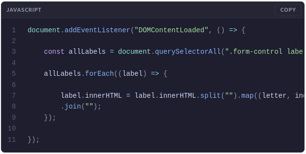
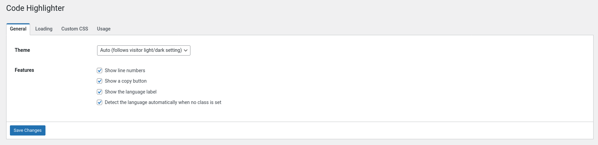

<p align="center"></p>

# Synhigh Code Highlighter

Lightweight syntax highlighting for WordPress with auto language detection, line numbers, and a copy button.

Synhigh highlights the code blocks you already write the native **Code** and **Preformatted** blocks with zero configuration. No external libraries, no CDN requests, no build step: a single small script and stylesheet, loaded only on pages that actually contain code.

## Features

- **Automatic language detection** — signature-based scoring guesses the language when no class is set.
- **18 built-in languages** with common aliases (see below).
- **Line numbers** with a custom starting line (`data-start`).
- **One-click copy button** with Clipboard API + legacy fallback, translated labels.
- **Language label** shown above each block.
- **4 themes**: Auto (follows the visitor's light/dark preference), Dark, Light, Ember — plus custom themes via CSS variables or JavaScript.
- **Smart loading** — assets load only on pages whose content contains a code block (single posts, archives, search).
- **MutationObserver support** for infinite scroll and AJAX page transitions (optional).
- **Editor-safe** — never touches blocks inside the Gutenberg/classic editor.
- **Clean uninstall** — removes its options when deleted.

## Requirements

| Requirement | Version |
| ----------- | ------- |
| WordPress   | 7.1+    |
| PHP         | 8.0+    |

## Installation

1. Upload the `synhigh-wordpress` folder to `/wp-content/plugins/`.
2. Activate **Synhigh Code Highlighter** through the *Plugins* screen.
3. Done — code blocks are highlighted automatically. Adjust options under **Settings → Code Highlighter**.

## Usage

Add a **Code** block (or Preformatted block) and paste your code. That's it — the language is detected automatically.

To set the language explicitly, open the block's **Advanced → Additional CSS class(es)** field and enter a class such as:

```
language-php
```

Accepted hint formats: `language-php`, `lang-php`, `brush: php`, or a bare `php`. Aliases work too (`js`, `ts`, `py`, `yml`, `sh`, …). Hints are also read from `data-synhigh-lang`, `data-lang`, and `data-language` attributes.

### Skipping a block

Add the class `nohighlight` (or `language-plaintext`, `synhigh-off`, …) to leave a block untouched.

### Per-block options

| Attribute            | Effect                                    |
| ---------------------- | ----------------------------------------- |
| `data-line-numbers="false"` | Hide line numbers for this block only |
| `data-start="10"`      | Start line numbering at 10                |

## Supported languages

| Language   | Aliases (examples)                                        |
| ---------- | --------------------------------------------------------- |
| HTML       | `xml`, `svg`, `xhtml`, `markup`, `vue`                    |
| CSS        | `scss`, `sass`, `less`                                    |
| JavaScript | `js`, `jsx`, `typescript`, `ts`, `tsx`, `node`            |
| JSON       | `jsonc`, `jsonld`, `geojson`                              |
| PHP        | `phtml`, `blade`, `laravel`                               |
| SQL        | `mysql`, `pgsql`, `postgresql`, `sqlite`, `mariadb`       |
| Python     | `py`, `py3`, `python3`                                    |
| Bash       | `sh`, `shell`, `zsh`, `console`, `terminal`               |
| C          | `h`, `objc`, `cuda`, `arduino`                            |
| C++        | `cpp`                                                     |
| Java       | `java`                                                    |
| C#         | `csharp`                                                  |
| Go         | `go`                                                      |
| Rust       | `rs`                                                      |
| YAML       | `yml`, `toml`, `ini`, `conf`, `env`, `dotenv`             |
| Ruby       | `rb`, `rake`, `gemfile`                                   |
| Diff       | `patch`                                                   |
| Markdown   | `md`, `mdx`                                               |

Embedded regions are highlighted too — e.g. JavaScript/CSS inside HTML, or PHP inside markup.

## Settings

**Settings → Code Highlighter**, organized in four tabs:

### General
- **Theme** — Auto, Dark, Light, or Ember.
- **Show line numbers**
- **Show a copy button**
- **Show the language label**
- **Detect the language automatically** when no class is set.

### Loading
- **Load on every page** — by default assets load only where a code block exists.
- **Watch for content added after page load** — enable for infinite scroll or AJAX themes.

### Custom CSS
Override any color for every theme using CSS variables:

```css
.synhigh {
	--synhigh-bg: #0b1d2a;
	--synhigh-keyword: #ff9e64;
}
```

Available variables include `--synhigh-bg`, `--synhigh-fg`, `--synhigh-muted`, `--synhigh-border`, `--synhigh-lineno`, `--synhigh-selection`, `--synhigh-comment`, `--synhigh-keyword`, `--synhigh-string`, `--synhigh-number`, `--synhigh-fn`, `--synhigh-var`, `--synhigh-type`, `--synhigh-const`, `--synhigh-op`, and more.

### Usage
A quick reference for the block class conventions above.

Custom themes registered this way can be selected via the `synhigh_js_config` filter (`theme` key) or by adding the class `synhigh-theme-ocean` to a wrapper.

Front-end configuration is read from `window.SynhighConfig`, printed before the script (`theme`, `lineNumbers`, `copyButton`, `showLabel`, `autoDetect`, `observe`, `i18n`).

## Uninstall

Deleting the plugin from the WordPress admin removes the `synhigh_options` option no leftover data.

# Screenshots

<table class="table">
  <thead>
    <tr>
      <th scope="col" width="1000px">Code Highlighter</th>
      <th scope="col" width="1000px">Admin Code Highlighter</th>
    </tr>
  </thead>
  <tbody>
    <tr>
      <td>
        
      </td>
      <td>
        
      </td>
    </tr>
  </tbody>
</table>
